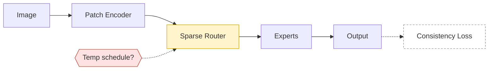

# method-spec.md — 中間表現テンプレート

すべての source mode（paper / code / design / discussion）は，図を設計する前にこの形式へまとめる．
`comic/<slug>/method-spec.md` に保存し，更新時は旧版を `comic/<slug>/spec-history/vN.md` に退避する．
図・prompt・Notion ページはすべてこの spec から作る（＝spec が正本）．

````markdown
# Method Spec: <手法名>
- version: v3 （前回: v2, 2026-10-21）
- updated: 2026-10-28
- mode: design （sources: notes + code + discussion）

## Sources
- [N1] notes: docs/plan.md
- [C1] code: src/ (commit abc1234)
- [D1] discussion: 2026-10-28 セッション T1–T48

## One-liner
<この手法は何を入力に，何を工夫して，何を出す／改善するのか．1〜2文>

## Components
| id | name | role | input → output | status | evidence |
|----|------|------|----------------|--------|----------|
| M1 | Patch Encoder | 画像をトークン列へ | img (B,3,H,W) → (B,N,D) | ✅ | [C1] src/model/encoder.py:L12-L58 |
| M2 | Sparse Router | トークンを k 個の専門家へ | (B,N,D) → idx (B,N,k) | 🟡 | [C1] src/model/router.py:L40 TODO / [D1] T22 |
| M3 | Consistency Loss | 2視点の出力を揃える | (B,N,D)×2 → scalar | ⬜ | [N1] §3.2 / [D1] T31 |
| M4 | Router の温度スケジュール | 学習中に温度を下げる | step → τ | ❓ | [D1] T40–T44（線形 or cosine 未決） |

## Data flow
- input → M1 → M2 → experts → merge → output
- 学習時のみ：output(view1), output(view2) → M3

## Key mechanisms（図の主役になる部分）
### K1: Sparse Router
- 何をする：...
- どう計算する：score = softmax(xW / τ) → top-k
- 小さな例：N=4 トークン，k=2 のときの割り当て例
- なぜ効く：...

## Decisions
| id | decision | reason | rejected alternatives | evidence |
|----|----------|--------|-----------------------|----------|
| DE1 | top-k ルーティング（k=2） | 計算量を一定に保つ | ✕ soft routing（メモリ過大） | [D1] T18–T22 |

## Open questions
- Q1: 温度スケジュールは線形か cosine か（[D1] T44）
- Q2: M3 を全層に掛けるか最終層のみか

## Discrepancies（論文/メモ ↔ コード）
- ⚠ 論文は LayerNorm 後に routing，コードは前（src/model/router.py:L35）

## Next actions
- [ ] M2 の TODO（負荷分散 loss）を実装
- [ ] Q1 を小規模実験で決める

## Changes since previous version
- M2: ⬜ → 🟡
- 追加: M4
- 削除: 旧 M5（discussion T30 で却下）

## Draft diagram

````

## 書き方のルール

- **status と evidence は必須**（paper mode では status は全て ✅，evidence は論文の節・Figure 番号）．
- evidence がない要素は描かない．推測で補った場合は「推定」と書き，Open questions に入れる．
- Key mechanisms は 1〜3 個に絞る．ここが機構細部図の候補になる．
- Draft diagram の Mermaid は節点テキストを短い英数字中心にし，`classDef` で状態を表す（implemented=通常，partial=黄，planned=破線，open=赤）．Notion でもそのまま描画される．
- paper / code mode で状態の区別が不要なら Decisions / Open questions / Next actions は省略してよい．
